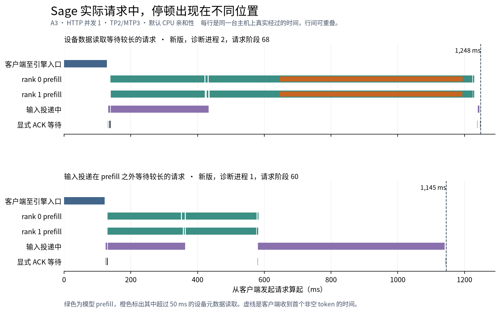

# A3 与 H200 的性能波动对照

对同一版本反复启动服务，A3 上的吞吐和首 token 延迟通常比此次 H200 记录更分散。A3 真实请求中的长停顿既出现在 TP worker 的设备读取，也出现在输入投递和输出返回。在去掉模型与 Ray 的独立实验中，同一台主机的 CPU18 仍能重现约半秒的停顿。

## 同一版本重新启动，吞吐有多大波动

每个进程先取 5 个批次的中位数，再看 5 个进程的中位数中间一半分布有多宽。表中用四分位间距除以中位数表示，越小越稳定。两台机器都使用这一算法，下面列出迁移后版本。

| 场景 | H200 吞吐波动 | A3 吞吐波动 | H200 首 token 波动 | A3 首 token 波动 |
|---|---:|---:|---:|---:|
| Agents-A1 HTTP C1 | 0.04% | 11.12% | 2.25% | 10.40% |
| Agents-A1 HTTP C4 | 0.59% | 8.97% | 3.12% | 4.93% |
| Sage MTP3 离线 C1 | 0.32% | 5.36% | 2.24% | 10.35% |
| Sage MTP3 离线 C4 | 0.09% | 4.14% | 1.57% | 6.96% |

A3 取前 5 个进程、每进程前 5 批来匹配样本数。使用 A3 全部 8 个进程时，Agents HTTP C1 与 Sage 离线 C1 的吞吐波动分别为 6.90% 和 1.71%。H200 也有例外，例如旧版 Agents HTTP C4 的首 token 波动达到 38.66%。各版本的绝对中位数、TPOT 和批数可逐行核对。[平台原始比较](evidence/a3-sage-host-20261118/platform-dispersion.csv)

H200 的 Sage 和 Agents 使用单卡 TP1。这两个模型的 TP 执行后端为 uni，每个模型步骤由一个 rank 完成。Sage MTP3 测的是离线 pipeline。A3 使用 TP2 和两个 Ray worker，开启 prefix，171 个输入即使未命中缓存，仍按 128 + 43 两段执行 target prefill。H200 的短负载为 167 输入、256 输出，prefix 关闭。A3 的 128 输出里，prefill 和偶发等待在整批用时中占比也会不同。现有 H200 记录支持同版本稳定性比较，未测量 Sage MTP3 HTTP C1 的请求 p95。两边 HTTP 都走聊天接口。在 H200 的 Agents 原始命令中没有启用 reasoning/tool 解析器，计时止于首个携带 token ID 的 SSE，5 次重复使用同一提示。A3 开启两个解析器，计时止于首个非空文本。 [H200 配置与原始批次](cuda_warm_performance_20261118.md) · [A3 运行形状](a3_c4_c8_performance_20261118.md)

## A3 单请求独立复测

同一组物理设备、Sage-A1.5 BF16、TP2/MTP3、171 输入、128 输出、greedy、关闭 thinking，使用正式 HTTP 聊天接口。迁移前固定 LMDeploy fb5de87a + dlinfer 3b909634，原生固定 2ccf38a4。两侧都用 CANN 9.1、Torch 2.10、Torch NPU 2.10.0.post4、Ray 2.48.0、Triton Ascend 3.2.2.post2。每次重启至少 20 个预热请求，最后两组各 4 条没有新增可观测形状、编译或图捕获，再做 3 个资格请求。

本轮在北京时间 11 月 18 日晚至 19 日凌晨进行。提前固定 10 对进程，交替旧版或新版先跑，每版每对 100 个不同、等长请求，同对同顺序，跑完一条才发下一条。2,000 条测量请求全部完成并保留，每条输出 128 个 token。资格和测量合计 1,030 对，完整输入输出 ID 均一致，同版本跨进程重放一致，缓存命中为零。每次有 25 个提示还与前轮记录逐 token 对上。原生服务及 worker 启用 dlinfer 导入检查。

| 首 token 延迟 | 旧版进程中位数 | 新版进程中位数 | 逐对变化中位数 | 95% 区间 | 新版较慢的进程对 |
|---|---:|---:|---:|---|---:|
| p50 | 618.0 ms | 634.8 ms | +2.23% | −2.95% 到 +5.20% | 6/10 |
| p90 | 664.2 ms | 686.8 ms | +2.88% | −1.75% 到 +5.61% | 6/10 |
| p95 | 693.3 ms | 705.3 ms | +2.34% | −3.67% 到 +9.95% | 6/10 |
| p99 | 745.7 ms | 1092.4 ms | +41.98% | +19.15% 到 +51.93% | 9/10 |

p95 是 95% 的请求在多少毫秒内收到首个非空 token，正百分比表示新版更慢。95% 区间衡量估计版本差异有多准，重抽的是整对进程。将每个版本的 1,000 个请求合并计算 p95，旧 726.0 ms、新 732.8 ms，变化 +0.93%，整对重抽区间 −4.18% 到 +10.21%。按预先约定的 ±5% 判据，该项仍不确定。超过 1 秒的请求旧版 5 条、新版 21 条。[10 个进程对](evidence/a3-sage-host-20261118/process-pairs.csv) · [2,000 条请求及阶段计时](evidence/a3-sage-host-20261118/http-c1-timing.csv)

默认设置下，极慢请求出现得更频繁。两个版本全部请求的 p99 分别为 804 和 1134 ms。超过一秒的比例由 0.5% 升至 2.1%，相差 1.6 个百分点，按进程对重抽的区间为 0.7 到 2.4 个百分点。p99 是次要描述指标。每轮仅 100 条，最慢的一两条就会改变单进程 p99。

前两轮每进程测 25 个 C1 请求，测量期间还穿插其他并发。它们的 p95 配对变化依次为 −1.53% 和 +3.06%，后一次有 7/8 对较慢。本次将单请求独立跑完，每个服务内的 p95 由 100 条请求估计。三次结果分别保留，单请求复测回答持续 C1 负载的问题。 [前两轮逐项结果](a3_c4_c8_performance_20261118.md)

## CPU 与 Ray 的独立对照

两台机器使用同一份纯 CPU Ray 脚本、Ray 2.48.0、NumPy 2.2.6。每次向两个 worker 发 8 KiB 输入，间隔 12 ms，再等待两次确认均到达。driver/worker 没有加载 Torch、NPU 或 ACL。无 Ray 对照只保留 C++、两个管道子进程和相同的 12 ms 休眠。CPU18 和 CPU19 在同一 NUMA 节点。

| 主机与实验 | 次数 | 超过 50 ms | 超过 300 ms | 最长 |
|---|---:|---:|---:|---:|
| A3 C++ 绑 CPU18，实际休眠 | 3,000 | 16 | 16 | 577.7 ms |
| A3 C++ 绑 CPU19，实际休眠 | 3,000 | 0 | 0 | 21.4 ms |
| A3 纯 Ray 默认，确认等待 | 12,000 | 14 | 6 | 566.4 ms |
| A3 纯 Ray 排除 CPU18，确认等待 | 12,000 | 5 | 1 | 339.5 ms |
| H200 纯 Ray 默认，确认等待 | 12,000 | 0 | 0 | 45.1 ms |

上表包含每次新集群的首笔提交。单列首笔之后的数据，A3 默认 / 排除 CPU18 各有 11,998 次等待，其中超过 300 ms 分别为 5 / 0 次。C++ 在 CPU18 的两次实验里，长休眠起点间隔的中位数为 2.57 和 2.56 秒。最长的 577.7 ms 休眠对应约 801 ms 的外部采样窗，其中 CPU18 软中断占 570 ms，CPU19 占 0 ms。此前更细的主机跟踪还记录到多个 Ray 线程在 CPU18 已可运行却排队 0.35–0.55 秒。具体触发的驱动或 IRQ 回调仍未确定。[逐轮计时及首次提交](evidence/a3-sage-host-20261118/host-controls.csv) · [原有线程调度证据](ray_host_latency_20261117.md)

## 真实请求的时间花在哪里

另开 8 个带探针的服务，每个测 60 条，请求和输出在同一组内一致。旧、新各用两个进程测默认亲和性，再各用两个进程只排除 CPU18。以下比较默认亲和性 4 个进程中各自最慢 3 条与靠近中位数的 12 条。以客户端第一次收到内容为界，将同一时钟上的区间取并集，两 rank 同时等待只算一次。

| 首 token 前的墙钟时间 | 中间 48 条均值 | 最慢 12 条均值 | 增量 |
|---|---:|---:|---:|
| 任一 rank 在 target/draft prefill 内 | 474.4 ms | 797.9 ms | +323.4 ms |
| 等待前次 Ray 确认，扣除与 prefill 重叠部分 | 5.9 ms | 6.9 ms | +0.9 ms |
| 输入尚未送达 worker，扣除与前两项重叠部分 | 15.8 ms | 61.2 ms | +45.4 ms |
| 其余时间，含请求解析和输出返回 | 149.8 ms | 154.8 ms | +5.0 ms |
| 整个请求的 TTFT | 645.9 ms | 1020.7 ms | +374.8 ms |

在途投递包含对象序列化、actor 排队及主机调度，也可与 worker 上其他工作并行。这列给出可归入该区间的上界。prefill 包含线程执行和设备/另一 rank 就绪前的等待。NPU event 之间也包含 host 提交空档。[480 条请求的等待区间](evidence/a3-sage-host-20261118/model-timelines.csv)

同一版本、同一提示顺序下，将端到端模型进程排除 CPU18 后，四次 p95 变化依次为 −1.38%、+8.23%、+1.49%、−43.16%（旧版两次、新版两次）。默认 / 排除 CPU18 各 240 条中，超过 1 秒的请求为 13 / 0 条，最长为 1301 / 805 ms。每组仅 60 条、每版两个进程。这是对本机亲和性的诊断，正式迁移对照使用默认亲和性。

观察到默认设置下超过 1 秒的比例不同后，又用与正式复测完全相同的轻量计时各跑 2 个进程，每个 100 条，仅排除 CPU18。提示和顺序与默认实验前两对一致，206 对资格及计时响应逐 token 一致。此时旧、新分别有 0/200 和 0/200 条超过 1 秒。合并 p95 为 701 → 691 ms，p99 为 720 → 720 ms，最长为 745 → 763 ms。这两对检验亲和性的影响，样本保留为独立条件。[相同轻量观测的 400 条亲和性对照](evidence/a3-sage-host-20261118/affinity-confirmation.csv)

又单独跟踪旧、新各 60 条请求，将驱动的输出等待逐次和 rank 0 的 RPC 入口、返回配对，两版各 4,118 次。下面是同一个新版服务里最慢的三条，三条均无超过 5 ms 的已记录 GC 与下列长区间重叠。

| 请求的 TTFT | 慢在什么位置 | 同窗观测 |
|---:|---|---|
| 1,128 ms | worker 已返回输出，到驱动恢复用了 410 ms | driver 心跳晚了 529 ms，线程 CPU 时间仅 0.11 ms，起止都在 CPU18。约 600 ms 的外部采样窗中，CPU18 软中断占 470 ms。 |
| 1,167 ms | 43 token 的 target prefill 中，两 rank 在卷积读取序列长度时均等了约 518 ms | rank 0 的读取线程实际用了 1.3 ms CPU，起止都在 CPU18。约 600 ms 采样窗中，CPU18 软中断占 520 ms。读取会等待先前设备工作，不能用这段时间衡量卷积 kernel 本身。 |
| 1,186 ms | 同一次提交到两个 actor 入口都约 776 ms，其中约 544 ms 与已观测 prefill 和显式 ACK 均无重叠 | 两个 actor 收到输入后，提交处理各不到 0.05 ms。约 801 ms 采样窗中，CPU18 软中断占 540 ms。 |

真实时间线中，主机停顿会表现在 Ray 投递或驱动恢复上。设备读取的例子里，两 rank 的等待几乎完全重合，符合 TP 同步会放大单个 rank 延迟的机制。单凭墙钟或软中断占用仍无法分摊每条请求中的调度、前序设备工作和集合通信时间。[主机与事件对时](evidence/a3-sage-host-20261118/worker-host-events.csv) · [前后端时间分解](evidence/a3-sage-host-20261118/frontend-worker-timelines.csv)

在正式测量有采样覆盖的 1,803 条请求中，取发起后固定 400 ms 的 CPU18 软中断占比，与该次 TTFT 作进程内秩相关。覆盖完整的各进程相关系数中位数为 -0.01。同一采样范围内，容器因 CPU 配额被限流的计数增加了 0 次。固定窗的平均占比很难预测单条请求会慢多久，关键线程在哪个核运行会影响它是否遇到该停顿。

两版 HTTP 解析器还各有一笔固定 CPU 开销。在 120 条补充请求中，每条都调用一次 tokenizer.get_vocab() 读取 248,077 项，仅取两个推理标签 ID。真实调用中位数旧版 119.8 ms，新版 120.2 ms，线程 CPU 时间分别为 119.5 和 120.0 ms。在单独 CPU 微测中只查这两个标签，30 次查得相同 ID，每次中位数分别为 0.014 和 0.013 ms。这解释了聊天入口的一部分固定成本。两版解析器文件哈希相同。另一个会放大调度抖动的因素是 prefill 的同步频率，实测每条每 rank 约 540 次已观测的设备元数据读取。 [解析器实现](https://github.com/silencelamb/lmdeploy/blob/2ccf38a43f0fdc7415ce4ce9f177852bdacc9966/lmdeploy/serve/parsers/response_parser.py#L746-L773) · [卷积序列长度读取](https://github.com/silencelamb/lmdeploy/blob/2ccf38a43f0fdc7415ce4ce9f177852bdacc9966/lmdeploy/pytorch/kernels/ascend/triton_ops/causal_conv1d.py#L106-L110)

独立尝试 A3 同一模型的本地多进程执行器时，首条 128 token 预热完成，第二条超过 314 秒未完成，因此没有可比较的稳态数据。早期 Agents 同一 worker 内切换 gated norm 时，该组件 C1/C4 每 rank 的预填充差为 0.07–0.88 ms，独立八对 norm64 复测中旧的 C4 吞吐下降方向也未复现。现有数据没有把 Sage 的半秒级停顿指向 norm 重构。 [同 worker 组件对照](a3_warm_performance_20261118.md#同-worker-组件归因与原始证据) · [独立 norm64 复测](a3_c4_c8_performance_20261118.md)

所有主测、带探针的模型运行和 CPU 对照按时间串行，设备与 CPU 亲和性仅在独立的诊断进程上作控制。逐请求、逐进程和平台统计可直接复算。[数据说明](evidence/a3-sage-host-20261118/README.md)
