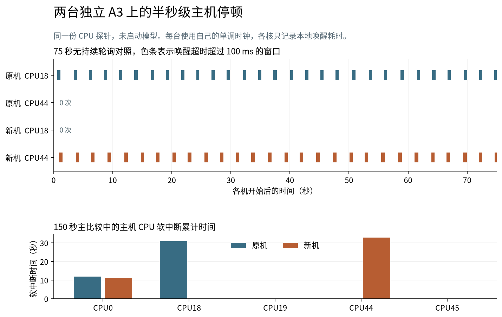

# 两台 Ascend A3 的周期性 CPU 停顿与首 token 长尾

2026 年 11 月 19 日。本文记录 LMDeploy Ascend 迁移验证中，一类约半秒的首 token 长尾如何从 HTTP 请求定位到宿主 Linux 的定时器软中断，以及怎样在另一台机器上独立核对。

**两台独立 A3 都复现了约半秒的单核停顿。** 原机 A 的热点是 CPU18，第二台整机 B 的热点是 CPU44。两台各测 75 秒，不运行模型、Ray 或 NPU 算子，只让 C++ 线程定时唤醒，分别出现 **29 次、28 次**超过期限 100 ms 的情况。同机邻核均为零。进一步对时将开销收窄到 Linux 的常规定时器软中断 `TIMER`。具体哪个回调占用时间、由哪个模块注册，仍缺宿主机函数级记录。已有证据支持它会放大服务长尾，无法据此估计其他 A3 的发生率。

[逐项证据与校验方法](evidence/a3-host-timer-20261119/README.md) · [容器探针下载](evidence/a3-host-timer-20261119/container-kit.tar.gz?raw=true) · [宿主机采集工具下载](evidence/a3-host-timer-20261119/host-kit.tar.gz?raw=true)

## 1. 从哪一组性能结果开始查

原机上的 Sage-A1.5 BF16，TP2、MTP3、HTTP 单并发（C1），迁移前固定为 LMDeploy `fb5de87a` + dlinfer `3b909634`，迁移后为原生 LMDeploy `2ccf38a4`，迁移后服务和 worker 启用 dlinfer 导入检查。两侧使用相同物理 NPU、CANN 9.1、Torch 2.10、Ray 2.48.0。输入 171 token，输出 128 token，greedy，关闭 thinking，测量请求均未命中前缀缓存。每对服务预热后按相同顺序各跑 100 条，首 token 延迟（TTFT）从本地客户端发出请求算到首次收到非空内容。下面的秒数和百分位都指 **TTFT**。

| 原机上的实验 | 迁移前 | 迁移后 | 可回答的问题 |
|---|---:|---:|---|
| 首轮 10 对重启，每版 1,000 条 | 5 条 >1 s | 21 条 >1 s | 这一轮确有差异。全部请求合并，p95 为 726 / 733 ms，p99 为 804 / 1,134 ms |
| 新开 10 对服务复测，每版 1,000 条 | 9 条 >1 s | 12 条 >1 s | 长尾在两版都出现，计数差从 16 条缩至 3 条 |
| 其中调度事件完整的 8 对，每版 800 条 | 36 条（4.50%） | 28 条（3.50%） | 每个请求的前 400 ms 内，HTTP 处理、Ray driver、两个 TP rank 的去重关键线程，至少一次实际切入 CPU18 |
| 单独排除 CPU18，2 对重启，每版 200 条 | 0 条 >1 s，p99 约 720 ms | 0 条 >1 s，p99 约 720 ms | 只改变该机服务亲和性，按相同输入复测。两对样本用于检验干扰路径 |

**同一台机器为什么能得到 5 条和 21 条？** 同机保证共享同一个干扰源，单条请求与它重合的时刻、所在核、当时等待的线程仍可以不同。首轮主机计数完整的 9 对中，CPU18 的软中断用时占比旧版 20.73%、新版 20.86%。26 条慢请求中有 23 条能完整对上主机计数（旧 4/5，新 19/21），这 23 条请求内部均出现至少 300 ms 的 CPU18 软中断用时，中位数旧 525、新 530 ms。也有普通请求遇到同样长的软中断（旧 113/899，新 122/881）。首轮没有逐线程调度记录，保留这 3 条计数缺失，无法给那 26 条逐一指定致慢线程。[首轮逐条慢请求](evidence/a3-host-timer-20261119/original-slow-requests.csv) · [正式 HTTP 计时与输入对照](a3_host_variability_20261118.md)

在新开的 10 对服务中，全部 21 条慢请求均有至少一类作业线程在 CPU18 上就绪、实际执行时间很少，并与定时器长窗累计重合至少 300 ms。未满 1 秒的请求也有同样现象（旧 22/991，新 20/988）。例如一次 1,318 ms 的新版请求中，rank 0 的 `worker.io` 在 CPU18 就绪而少获执行的区间与长窗重合了 540 ms。这里的就绪状态、最后所在 CPU 和内核实际切入是三种不同的观测。比较两版关键线程落点用的是实际切入事件，且每条请求只取等长的前 400 ms。8 对重启的新版减旧版为 **−1.00 个百分点**，按整对进程重抽 10,000 次所得 95% 区间为 **−5.13 至 +2.25 个百分点**。数据没有显示新版关键线程稳定地更常落到 CPU18。Ray 通信辅助线程的早期落点比例为 25.88% / 30.00%，8 对中各有 4 对朝相反方向变化。[复测的 2,000 条请求](evidence/a3-host-timer-20261119/fresh-requests.csv.gz?raw=true) · [逐对真实调度结果](evidence/a3-host-timer-20261119/paired-placement.csv)

**与 H200、Ray、算子的关系。** 同版本 5 次服务重启、每次取 5 个批次，用进程级吞吐的四分位间距除以中位数衡量离散程度。迁移后的 Agents HTTP C1 在 H200 / A3 分别为 0.04% / 11.12%，Sage 离线 C4 为 0.09% / 4.14%。H200 用单卡 TP1，A3 用 TP2 与两个 Ray worker，负载长度和部分计时端点也不同。单独运行同一套纯 CPU Ray 双 worker 对照，H200 默认配置 12,000 次确认等待中没有一次超过 50 ms，A3 默认配置有 6 次超过 300 ms。再去掉 Ray，A3 绑热点核的 C++ 探针仍能复现。Ray 或 NPU 同步处可以让请求等到这个停顿，触发下面的主机现象不需要它们。已测 Agents 同一 worker 内的 gated norm 对照，预填充差为每 rank 0.07–0.88 ms。现有结果没有把这类半秒停顿指向 norm。C1/C4/C8 的**输出吞吐**另以每秒生成的 token 数衡量，两个模型正式 HTTP 配对中位变化在 −2.47% 至 +1.97%。[H200、Ray 与模型阶段对照](a3_host_variability_20261118.md) · [吞吐与并发对照](a3_c4_c8_performance_20261118.md)

## 2. 哪两台机器，CPU 编号如何理解

| 条件 | 原机 A | 独立整机 B |
|---|---|---|
| 机器身份 | Atlas 900 A3 SuperPoD 计算节点 | 同型号，DMI 产品 UUID 和 Linux boot ID 均与 A 不同 |
| 主机 CPU | 320 个在线逻辑 CPU，4 个 CPU package，8 个 NUMA 节点，每节点 40 个逻辑 CPU | 相同 |
| 工作容器允许的 CPU 编号 | 0–171、173–319，共 319 个 | 相同 |
| cgroup CPU 时间配额 | 128 核等效 | 256 核等效 |
| 作业可见 NPU | 4 卡 / 8 die，物理 die 0、1、8–13 | 8 卡 / 16 die，物理 die 0–15 |
| 实测异常 Linux CPU | CPU18，package 0、NUMA 0 | CPU44，package 0、NUMA 1 |

这里的 CPU18 / CPU44 是宿主 Linux 逻辑核号。NPU 卡和 die 描述加速器分配，CPU 配额限制一段时间内可用的总 CPU 时间，允许集合决定线程能绑定到哪些核。两边的主实验里 cgroup 配额限流次数增量都为 0。此前两个分到互补 die 的容器入口属于同一物理节点，此处按物理机计数。

两机使用相同的主板型号、Linux `5.10.0-216.0.0.115.oe2203sp4.shengteng.aarch64` 和 Ascend PCIe 主机驱动构建标识。内核配置均为 `CONFIG_HZ=250`、`CONFIG_PREEMPT_NONE=y`、`CONFIG_IRQ_TIME_ACCOUNTING=y`。两端本地运行同一份 CPU 探针，各用自己的单调时钟计算间隔，SSH 往返不参与计时。B 运行了主机探针，Sage 新旧版本的模型数据来自 A。

## 3. 不启动推理服务，直接复现停顿

一个 C++ 线程绑定一个核，按 `CLOCK_MONOTONIC` 调用绝对期限睡眠。预计 12 ms 后唤醒，记录**实醒时刻减应醒时刻**。每次从实醒时刻开始安排下一次，因此一次半秒停顿只计一次。先在每台 10 个代表核测 150 秒，同时每 100 ms 读全部 320 核的 `/proc/stat`。A 的 CPU18 有 56 次额外等待 >100 ms（最大 574.2 ms），B 的 CPU18 为 0 次（最大 11.0 ms）。全机软中断累计时间最高的核分别是 A 的 CPU18（30.83 秒）和 B 的 CPU44（32.77 秒）。

再将每台可绑定的 319 个核按核号模 4 分成四批，每批主动测 40 秒，CPU18 和 CPU19 每批都测。只有 A 的 CPU18（累计 160 秒，61 次，最大 569.9 ms）和 B 的 CPU44（40 秒，15 次，最大 634.7 ms）出现 >100 ms。CPU172 只纳入主机被动计数。两热点的这两个次数有不同的观测时长，下面的 75 秒才是等时比较。[两台机器逐核筛查](evidence/a3-host-timer-20261119/all-core-scan.csv)

首次采样的观察器使用过 CPU44。找到 B 的热点后，将连续采样移到 CPU84/85，最后再单独跑一轮**完全没有持续轮询**的四核测量，仅在起止读取 CPU 总账。

| 75 秒，每核同样测试 | >100 ms 次数 | 最大额外等待 | 长窗起点间隔中位数 | 软中断 / 硬中断用时 |
|---|---:|---:|---:|---:|
| A · CPU18 | **29** | **570.3 ms** | 2.567 s | 15.77 / 0.09 s |
| A · CPU19 / CPU44 / CPU45 | 0 / 0 / 0 | 9.4 / 9.5 / 9.1 ms | — | 各核软中断 ≤0.02 s |
| B · CPU44 | **28** | **625.4 ms** | 2.809 s | 16.45 / 0.08 s |
| B · CPU18 / CPU19 / CPU45 | 0 / 0 / 0 | 6.7 / 13.4 / 4.4 ms | — | 各核软中断 ≤0.02 s |

长窗额外等待的中位数分别为 543.6 和 591.4 ms。在当前配置的两台机器上，热点确实存在，但核号随节点而异。排除 CPU18 是 A 节点上验证过的临时措施。对其他节点应先测出热点。[47,127 条应醒与实醒记录](evidence/a3-host-timer-20261119/quiet-wakeups.csv.gz?raw=true) · [四核计数与分位数](evidence/a3-host-timer-20261119/measurements.json)



## 4. 停顿时，这个核在执行什么

**向量。** 在热点和邻核各启动一个探针。一轮请求 1 ms 睡眠，另一轮一直运行、连续读时钟，同时读线程自身 CPU 时间。另一个核约每 1 ms 读取 `/proc/softirqs`。这个接口按核记录每类软中断进入次数，`/proc/stat` 则给出各类软中断合计用时。查找应用停顿中点前后相邻的两次向量计数变化，只有两端各与应用停顿边界相差 ≤10 ms 才计入“边界完整”。一个采样格内改变多个向量时保留全部名字。这里的 `TIMER` 是常规定时器的软中断向量，另有独立的 `HRTIMER` 向量。[Linux 5.10 的软中断入口计数和分派](https://github.com/torvalds/linux/blob/v5.10/kernel/softirq.c#L258-L298)

| 每组 100 秒，观察器与目标分核 | >100 ms | 边界完整 | 完整长窗前最后增加的向量 |
|---|---:|---:|---|
| A · CPU18，1 ms 睡眠 | 38 | 37 | 37 次 TIMER |
| A · CPU18，持续取时 | 39 | 38 | 38 次 TIMER |
| B · CPU44，1 ms 睡眠 | 38 | 37 | 37 次 TIMER |
| B · CPU44，持续取时 | 37 | 36 | 35 次 TIMER，1 次 TIMER 和 RCU 同格 |

四组邻核均无 >100 ms。额外的同核号对照 A·CPU44 和 B·CPU18 在 1 ms 睡眠下也均为零。B·CPU44 的 37 个完整睡眠长窗外围，软中断计时增量中位数为 590 ms，硬中断计时中位数为 0 ms（计账粒度 10 ms）。普通容器能看到入口变化和总用时，具体函数需看下文的回调事件。[152 个长窗，含无法对齐的边缘样本](evidence/a3-host-timer-20261119/vector-windows.csv) · [原机现场时间线](evidence/a3-host-timer-20261119/irq-timeline.png)

**调度与硬中断。** 再让每个被测核先有一条、再有两条同优先级、一直就绪的线程。由独立 CPU 分别采集向量、架构时钟硬中断 `arch_timer` 的逐核计数、自有线程的内核切入/切出事件 `PERF_RECORD_SWITCH`，以及 `/proc/schedstat` 的时间片。每个长窗首尾各去掉 15 ms，对照为同核提前 1 秒的等长正常窗口。

| 节点与被测线程 | 完整长窗 | 程序停顿中位数 | 长窗中段实际切入/切出 | 中段 / 正常窗硬时钟 IRQ 中位数 | 中段 / 正常窗时间片增量中位数 |
|---|---:|---:|---:|---:|---:|
| A · 单线程 | 37 | 554.5 ms | 0 / 0 | 131 / 131 | 0 / 0 |
| A · 双线程共同停顿 | 37 | 557.8 ms | 0 / 0 | 131 / 131 | 0 / 33 |
| B · 单线程 | 36 | 589.8 ms | 0 / 0 | 139 / 139 | 0 / 2 |
| B · 双线程共同停顿 | 37 | 592.9 ms | 0 / 0 | 140 / 140 | 0 / 35 |

147 个独立长窗的中段均有硬时钟 IRQ 到达，均无实验线程切换，采到的运行队列时间片增量每次都是零。其中一条实验线程始终是调度器选中的当前任务（`current`），单线程本身获得的 CPU 时间中位数却只有 A 2.23 ms、B 0.75 ms。这与 Linux 在当前任务上下文执行 `TIMER` 软中断、期间仍能响应硬中断的机制相符。普通用户线程轮转、长期切给 `ksoftirqd`、整段关闭硬中断或整核停钟，都解释不了这些窗口的中段。

双线程统计取两个线程停顿的交集，从最后一个停止进展，到第一个恢复。只用主线程的起止点做相同的 ±10 ms 匹配，A/B 分别只剩 5/7 个，正常时间片轮转会移动个别线程的端点。这两种口径来自同一批记录，表中只计共同停顿。A 有 1 个同伴线程的边缘缺口未配对。硬件时钟和时间片的正常对照因接近采集起点缺 3 个，实际为 144 个。正式调度事件记录无丢失。[147 个窗口及同核正常对照](evidence/a3-host-timer-20261119/context-windows.csv) · [Linux 调度计数定义](https://docs.kernel.org/scheduler/sched-stats.html)

**是哪个定时器？** 先固定一个可检验的规则，再在两台各采全新 100 秒。内核为 250 Hz，从上一停顿结束加 500 tick（约 2 秒），按 Linux 定时器轮 8 或 64 tick 的桶生成两个候选到期时刻。实测下一停顿起点距任一候选 ≤5 ms 算命中。同机相邻且边界完整的间隔中，A 命中 36/37，B 命中 35/35，共 **71/72**。改用之前拟合的固定起点周期分别命中 32/37、28/35，打乱前次时长 3,000 次后命中数中位数为 28、25。直接观测到“前次结束到下次开始”的中位间隔是 2,029 和 2,168 ms。这个规律值得在跟踪中检查“回调末尾是否把同一 timer 重新挂约 500 tick”，仍无法从时间规律推出模块名、两个节点的回调是否相同或源码参数必为 2,000 ms。[采前固定的规则](evidence/a3-host-timer-20261119/holdout-plan.md) · [72 个间隔的观测与预测](evidence/a3-host-timer-20261119/timing-holdout.csv) · [Linux 定时器轮的取整实现](https://github.com/torvalds/linux/blob/v5.10/kernel/time/timer.c#L460-L491)

原机上还专门核对过一个 Ascend PCIe 消息硬中断。58 个长窗起点附近有 17 次计数增加，等宽且提前约 200 ms 的正常窗里也有 15 次。这个 IRQ 没有在每次停顿开始时到达。现阶段仍可能是单个回调慢、多个到期回调累计慢，或回调内部等待。需要实际的函数名、跨度和必要时的内核栈来区分。

## 5. 如何在普通 A3 工作容器复现

下载前面的容器工具包到当前目录。基础采集需要 Linux、Python 3、C++17 编译器、make 和 zlib 开发头文件。先查工作容器允许的 CPU，按核号扫描，所有结果写入新的目录。下面先给出未知节点的用法。

```bash
mkdir a3-probes
tar -xzf container-kit.tar.gz -C a3-probes
cd a3-probes
make
python3 -c 'import os; print(sorted(os.sched_getaffinity(0)))'
python3 probe.py scan --cpus allowed --groups 4 --seconds 40 --out scan-run
```

读 `scan-run/scan.csv` 的 `over100`、`over300`、`max_late_ms` 和 `softirq_s`。用“长唤醒反复发生并伴随软中断用时集中”的核做候选。扫描 40 秒内为零，只说明这个窗口未捕获长停顿。如需精确复现本文四批的时长设计，且 CPU18、19 都允许，在上一命令加 `--sentinels 18,19`。要复现最初的 150 秒被动全机计数，使用以下命令。这里选 CPU84 读取计数，让 CPU44 也能独立接受复核。

```bash
python3 probe.py screen --cpus 18,19,42,58,98,138,178,218,258,298 \
  --vector-cpu 18 --observer 84 --seconds 150 --out screen-run
```

下面以 B 的 CPU44 为例。CPU45 是同 NUMA 对照，CPU84 只负责读向量。A 取 `hot=18`、`control=19`。其他机器按实际允许集合、NUMA 拓扑和扫描结果选核。三个测量顺序执行，避免细粒度轮询进入安静对照。原生探针按前缀写结果，每次使用新目录。

```bash
hot=44
control=45
observer=84
mkdir run-hot
./wakeup run-hot/quiet 75 18 19 44 45
python3 probe.py wake-summary --prefix run-hot/quiet --cpus 18,19,44,45

./fine_irq run-hot/sleep 100 sleep "$hot" "$control" "$observer"
python3 probe.py fine-summary --prefix run-hot/sleep --cpu "$hot" --control "$control"

./fine_irq run-hot/spin 100 spin "$hot" "$control" "$observer"
python3 probe.py fine-summary --prefix run-hot/spin --cpu "$hot" --control "$control"
```

`wakeup` 保存每次应醒和实醒的单调时刻。安静对照的 4 个核可换成所在节点允许的若干核。`fine_irq` 输出两核的长间隔、线程实际 CPU 时间和独立采样器的向量计数。`by_cpu` 是每核超过阈值的实数，`tight` 是边界能对齐的数量，`last_vectors_in_tight_cases` 给出这些长窗入口前的向量组合。持续取时会实际占用目标核和对照核，应在用于诊断的测量窗口运行。若另一台没有相同热点，记录零结果、观测时长和所测核号即可。

要复现第 4 节的线程调度对照，还需要允许读取自有任务的 perf 调度事件、可读的架构时钟 IRQ 逐核计数、`taskset` 和用于离线分析的 NumPy。示例中的四个观察核依次读取软中断、硬时钟中断、调度事件和系统总账。选六个互不重叠的可用核。

```bash
make context
python3 run_context.py --hot "$hot" --control "$control" \
  --observers 84 85 86 87 --seconds 100 --out ctx-hot
python3 analyze_context.py ctx-hot --out ctx-hot-analysis.json
```

`single` 和 `dual` 各采 100 秒，分析文件中的 `dual_intersection` 是后者的双线程交集。先看 `quality` 和 `excluded`，再看有效事件的 `hot_switch_ins/outs`、`hot.sched_slices`、`hot.irq_count` 和提前一秒的 `pre` 对照。本文发布的容器包已从新目录编译并在 A 上实跑，也用它重放了 A/B 的完整原始调度记录，逐窗数据与原分析一致。基础筛查使用标准库和 C++，无需安装模型、LMDeploy 或 Ray。[工具和输出字段说明](evidence/a3-host-timer-20261119/README.md)

## 6. 如何在宿主机确认慢回调

两个普通工作容器均能记录自己线程的用户态调度事件，申请内核指令采样均返回 `EACCES`，内核也未向它们开放所需的 tracefs 定时器事件。要从 `TIMER` 追到函数，让能访问**同一宿主内核**跟踪事件的宿主机、已授权诊断容器或平台采集器，在热点核旁路采 60 秒即可。工作负载可以继续留在原容器，主机探针在无推理负载时也已复现。以下按 B 的 CPU44 演示，A 换成 CPU18。

```bash
mkdir a3-host-kit
tar -xzf host-kit.tar.gz -C a3-host-kit
cd a3-host-kit
python3 capture_timer.py --cpu 44 --check
python3 capture_timer.py --cpu 44 --seconds 60 --out timer44-run
```

`--check` 输出私有 tracefs 实例是否可建、各事件是否可见。退出码 0 表示这些前提通过，本次两个工作容器均为 2。采集器使用 Python 标准库，建立独立 tracefs 实例，将采集掩码限于指定 CPU，配对 `irq:softirq_entry/exit` 的 TIMER 区间、`timer:timer_expire_entry/exit` 的回调和对象，同时记录可见的嵌套硬 IRQ。内核若提供 `timer:timer_start`，也记录重设定时器的信息。采集结束后移除自己的跟踪实例。回调入口包含注册的函数，出口与入口可按对象配对。[采集器源码](evidence/a3-host-timer-20261119/capture_timer.py) · [内核调用回调的位置](https://github.com/torvalds/linux/blob/v5.10/kernel/time/timer.c#L1321-L1323) · [timer 跟踪事件字段](https://github.com/torvalds/linux/blob/v5.10/include/trace/events/timer.h#L77-L120)

带回整个 `timer44-run/` 目录。它包含采集设置 `metadata.json`、原始事件 `trace.txt`、缓冲区计数 `buffer-stats.txt` 和排名 `summary.json`。普通工作容器可离线重算，在有完整系统级 perf 权限且已安装 perf 的平台，也可使用包中的备用采集器。

```bash
python3 capture_timer.py --cpu 44 --parse timer44-run/trace.txt --out timer44-reparsed.json

# 使用 perf 后端时，单独执行这一组命令
python3 timer_capture.py --cpu 44 --check
python3 timer_capture.py --cpu 44 --seconds 60 --out timer44-perf
```

| 在主采集器的 summary.json 中查看 | 如何判读 |
|---|---|
| `loss_indicators`、`errors`、`complete_vectors`、`slow_vectors` | 先核对原始缓冲区丢失计数、完整向量数，以及是否捕到 ≥100 ms 的长窗。只用入口与出口配对完整且有效的窗口做归因。若无完整长窗，回到同核唤醒探针核对该时段能否复现 |
| `functions_in_complete_slow_vectors` 内的 `max_one_call_excluding_known_irq_ms` | 找单次耗时接近半秒、并在多个独立长窗重复出现的函数。已扣除可见的嵌套硬 IRQ，所得仍是墙钟跨度 |
| 同一函数的 `max_one_vector_sum_ms`、`calls`、`slow_vectors` | 若单次都短，检查一个 TIMER 向量里同一函数多次调用的总和，以及多个函数共同占用的时间 |
| `unexplained_after_callbacks_and_known_irqs_ms` | 若大部分时间仍在回调和可见硬 IRQ 之外，要继续看同窗内核栈、定时器分派或锁等待 |
| `same_object_rearm_timeout_ticks` 与符号 `[module]` | 查慢函数是否在本核重新挂同一对象、超时是否接近 500 tick，再核对符号所属模块。单核记录会漏掉别的核发起的重设。符号不可见时需匹配本次运行的内核及模块符号 |

宿主机采集器已用合成记录验证嵌套硬 IRQ 扣除、同对象重设、丢失与不完整配对，并通过 perf 文本的离线解析。**目前尚无两台实机的回调级 trace，也没有实测到慢函数名。** 一份无丢失、含多次完整长 TIMER 区间的回调记录，就能检验“单个慢函数还是多个短回调累计”，并决定是否还需栈采样。
