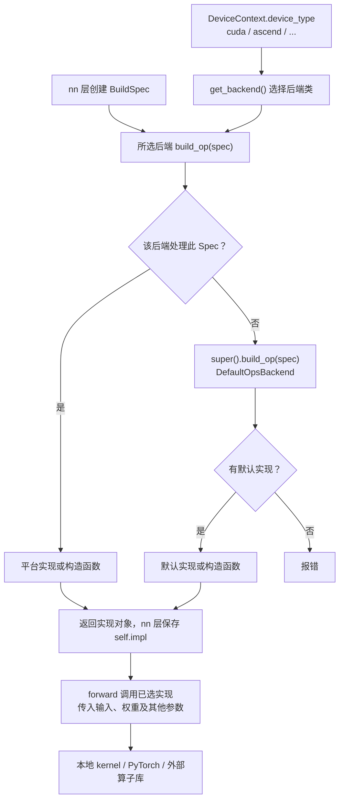

# RMSNormGated 按标准后端接口重构与验证

日期：2026-11-15，Asia/Shanghai。原始运行日志保留 UTC。

2026-11-16 补充：[性能定位与 A100 CI 结果](gated_norm_performance_20261116.md)。本文原始测量与失败记录保留；
新增交替对照没有稳定复现原来的 C4 −5.15%，实际 norm kernel 二进制相同，长停顿在主机提交等待处复现。
A100 CI 当时已执行并通过新增 norm 文件的 83 项（含 56 项真实 CUDA/graph），完整 GPU 模型对照尚未完成。
2026-11-17 更新：后续 H200 完整对照已完成，详见 [GPU 精度与性能报告](cuda_regression_20261116.md)；
下面保留原始 A3 重构数据及来源，新增设计范围说明，不将旧记录重标为新运行。

本次是在原生迁移 PR [#5134](https://github.com/InternLM/lmdeploy/pull/5134) 上补齐算子组织方式。
比较对象是冻结的重构前原生 PR `342db85ecff3c0dc864a4bf8613c589c270f4141` 与本次重构，
最终 PR 提交为 `5f1b1b3c12b1c198813f65275f778c7ad292fb02`，开发分支同步提交为
`7d984d0abce61849237d436ac4243fc964e93e7b`。不是重新把旧 dlinfer 环境当作本轮基线。历史 dlinfer/native 迁移对照仍见 [原始报告](migration_validation.md)。
完整报告和原始验证数据只进入 fork 的文档分支。

## 规范化范围：一个算子，三个直接模型调用点

这里需要区分三个计数：

| 计数对象 | 数量与含义 |
| --- | --- |
| nn/norm.py中的基础归一化公共Module | 3类：RMSNorm、LayerNorm、RMSNormGated |
| 本次补齐标准组织方式的算子 | **1类：RMSNormGated**；普通RMSNorm/LayerNorm是已有设计参照，不是本次全部重写 |
| RMSNormGated的直接模型构造位置 | **3处**：Qwen3NextGatedDeltaNet.norm、Qwen3_5GatedDeltaNet.norm、Glm5NextLinearAttention.o_norm；其派生模型共享这些调用点 |

SiLU、swish、sigmoid是RMSNormGated的activation配置，其中swish是SiLU别名，不是三个独立算子。这里的计数也不把已有量化变体、辅助函数或整个Ascend迁移的其他算子算成此次新增规范化算子。

## 先看其他算子如何选择后端

先看已有RMSNorm、LayerNorm和GatedDeltaRule的组织，再理解为什么RMSNormGated需要规范化。下面按当前固定PR源码2ccf38a4说明；图片中“RMSNormGated回到default/gated_norm.py并返回FLA Module”的路径属于重构前的342db85e，不能当作当前实现。

### 四层职责

这里的路径均相对于lmdeploy/pytorch：

| 层次 | 职责 | 本次norm重构中的对应物 |
| --- | --- | --- |
| `nn` | 提供模型使用的层；通常创建和注册权重、承接checkpoint加载，并按具体层需要处理TP切分等 | `nn.RMSNormGated`持有`weight`，模型只调用公共层 |
| `backends/*.py` | 定义算子接口和typed `BuildSpec`，描述要构造什么算子 | `RMSNormGatedImpl`和`RMSNormGatedBuildSpec` |
| `backends/cuda`、`ascend`、`default` | 根据Spec创建对应实现；平台特有逻辑与公共默认实现分开 | `CudaRMSNormGatedImpl`、`AscendRMSNormGatedImpl`、`DefaultRMSNormGatedImpl` |
| 具体计算层：`kernels`或外部算子库 | 执行计算；可以使用本地kernel，也可以直接调用PyTorch、FLA等库 | CUDA复用FLA functional；Ascend调用原Triton norm kernel |

这是职责分层，不要求所有调用都经过一个本地kernels文件。例如默认LayerNorm直接调用PyTorch，CUDA gated norm的共享adapter直接调用FLA。TP切分也不是每个nn层都必须执行；RMSNormGated由调用者提供相应维度，不因此新增一套TP权重切分规则。

### 两次主要选择：先选平台，再按Spec选算子

1. **选择平台后端类。** `get_backend()`读取当前`DeviceContext.device_type`，显式选择`CudaOpsBackend`、`AscendOpsBackend`等。也可以传入显式`device_type`，在临时设备上下文内进行同样选择。
2. **构造算子实现。** 选中的后端执行`build_op(spec)`，通过`isinstance(spec, XxxBuildSpec)`匹配请求，直接构造实现或调用该算子的构造函数。部分构造函数内部还会按dtype、形状、硬件能力选择具体provider，这属于算子内部策略。

这里的LMDeploy分派是显式Python逻辑，**不是扫描目录自动注册，也不是在每次forward时根据输入张量猜平台**。被选中实现内部调用PyTorch时，PyTorch自身仍会按张量设备调度底层kernel；这是另一层机制。

源码：[设备选择selector.py](https://github.com/InternLM/lmdeploy/blob/2ccf38a43f0fdc7415ce4ce9f177852bdacc9966/lmdeploy/pytorch/backends/selector.py#L7)、[CUDA分派入口](https://github.com/InternLM/lmdeploy/blob/2ccf38a43f0fdc7415ce4ce9f177852bdacc9966/lmdeploy/pytorch/backends/cuda/op_backend.py#L33)、[Ascend分派入口](https://github.com/InternLM/lmdeploy/blob/2ccf38a43f0fdc7415ce4ce9f177852bdacc9966/lmdeploy/pytorch/backends/ascend/op_backend.py#L173)。



### default究竟是什么

CudaOpsBackend和AscendOpsBackend都继承DefaultOpsBackend。某个Spec没有被该平台的分派分支处理时，函数末尾调用super().build_op(spec, ...)，由父类提供默认实现；父类也没有这个Spec时，抛出不支持异常。未知device_type则在selector处直接报错，不是选中default设备。

因此，default是**通过继承共享的默认实现集合**，不是切换到CPU，也不是平台算子运行失败后的自动重试。具体算子若另有provider/fallback策略，需要看它自身实现；不能把那些策略与这个super()分支混为一谈。已匹配平台Spec但不支持某个参数时，也可能直接报错而不走默认实现。

当前代码的回退位置：[CUDA末尾](https://github.com/InternLM/lmdeploy/blob/2ccf38a43f0fdc7415ce4ce9f177852bdacc9966/lmdeploy/pytorch/backends/cuda/op_backend.py#L223)、[Ascend末尾](https://github.com/InternLM/lmdeploy/blob/2ccf38a43f0fdc7415ce4ce9f177852bdacc9966/lmdeploy/pytorch/backends/ascend/op_backend.py#L317)、[默认分派及不支持报错](https://github.com/InternLM/lmdeploy/blob/2ccf38a43f0fdc7415ce4ce9f177852bdacc9966/lmdeploy/pytorch/backends/default/op_backend.py#L17)。

### 普通RMSNorm的构造与计算

以未量化、非融合的普通RMSNorm路径为例：

1. `nn.RMSNorm`创建并注册`weight`；启用该层TP时先确定本rank的维度和加载规则。
2. 创建`RMSNormBuildSpec(hidden_size, eps)`。
3. 调用选中后端的`build_op(spec)`，把实现对象保存为`self.impl`。
4. forward时调用`self.impl.forward(x, self.weight, residual)`。

平台实现对象在**构造阶段**选定，后续forward使用它，而不是每次重新选择设备后端。实现内部仍可以按输入形状选择kernel或调优配置。RMSNorm的量化、TP和通信融合扩展另有分支，这个例子只展示公共参数层与计算实现分离的基本结构。[nn.RMSNorm源码](https://github.com/InternLM/lmdeploy/blob/2ccf38a43f0fdc7415ce4ce9f177852bdacc9966/lmdeploy/pytorch/nn/norm.py#L74)。

### 几个已有算子的实际路径

以下是当前源码的四个分派示例，不表示本次同时重构了四个算子：

| 算子请求 | CUDA路径 | Ascend路径 |
| --- | --- | --- |
| `RMSNormBuildSpec` | `cuda/norm.py` → `TritonRMSNormImpl` | `ascend/norm.py` → `AscendRMSNormImpl` |
| `LayerNormBuildSpec` | 未单独匹配，回到`default/norm.py` → `DefaultLayerNormImpl` → PyTorch `layer_norm` | 同样回到`DefaultLayerNormImpl`；没有因此切换到CPU |
| `GatedDeltaRuleBuildSpec` | `cuda/gated_delta_rule.py` → `CudaGatedDeltaRuleImpl` | `ascend/gated_delta_rule.py` → `AscendGatedDeltaRuleImpl` |
| `RMSNormGatedBuildSpec`（重构后） | `cuda/norm.py` → `CudaRMSNormGatedImpl`；复用`DefaultRMSNormGatedImpl`中的FLA functional adapter | `ascend/norm.py` → `AscendRMSNormGatedImpl`；参数由公共nn层传入 |

对应分支：[CUDA norm](https://github.com/InternLM/lmdeploy/blob/2ccf38a43f0fdc7415ce4ce9f177852bdacc9966/lmdeploy/pytorch/backends/cuda/op_backend.py#L72)、[Ascend norm](https://github.com/InternLM/lmdeploy/blob/2ccf38a43f0fdc7415ce4ce9f177852bdacc9966/lmdeploy/pytorch/backends/ascend/op_backend.py#L223)、[默认LayerNorm](https://github.com/InternLM/lmdeploy/blob/2ccf38a43f0fdc7415ce4ce9f177852bdacc9966/lmdeploy/pytorch/backends/default/op_backend.py#L48)、[CUDA GDN](https://github.com/InternLM/lmdeploy/blob/2ccf38a43f0fdc7415ce4ce9f177852bdacc9966/lmdeploy/pytorch/backends/cuda/op_backend.py#L154)、[Ascend GDN](https://github.com/InternLM/lmdeploy/blob/2ccf38a43f0fdc7415ce4ce9f177852bdacc9966/lmdeploy/pytorch/backends/ascend/op_backend.py#L193)。

### 为什么截图里的gated norm路径需要改变

在重构前的342db85e中，CUDA没有单独处理RMSNormGatedBuildSpec，回到default/gated_norm.py返回整个FLA Module；Ascend直接返回自己的RMSNormGated Module。两者都让平台Module持有模型weight。这个“返回完整平台Module”的特例，才是它与普通RMSNorm组织方式不同的地方。

**使用default本身并不特殊，也不是问题。** LayerNorm就正常复用了默认实现。此次规范化的目标是统一norm的参数所有权和接口合同：公共nn层管理checkpoint参数，BuildSpec返回匹配计算接口的实现对象，平台实现只计算。当前CUDA虽然显式映射到CudaRMSNormGatedImpl，实际计算仍复用共享的FLA adapter；不需要为了“看起来原生”而重写已有CUDA kernel。

重构前源码：[默认返回FLA Module](https://github.com/InternLM/lmdeploy/blob/342db85ecff3c0dc864a4bf8613c589c270f4141/lmdeploy/pytorch/backends/default/gated_norm.py)、[Ascend返回带权重Module](https://github.com/InternLM/lmdeploy/blob/342db85ecff3c0dc864a4bf8613c589c270f4141/lmdeploy/pytorch/backends/ascend/op_backend.py#L175)。下表继续对比最终的职责划分。

## 由什么组织方式改成什么组织方式

| 设计维度 | 原有/迁移中间方案 | 最终规范化设计 |
| --- | --- | --- |
| 模型创建入口 | build_rmsnorm_gated特殊工厂；CUDA直接返回FLA的FusedRMSNormGated Module，Ascend通过外部patch替换工厂 | 模型统一创建LMDeploy自己的nn.RMSNormGated |
| 参数所有权 | 由工厂返回的平台Module管理weight；迁移中间方案仍由BuildSpec返回完整Module | 公共nn层创建、持有和加载weight；后端只接收weight参与计算 |
| 平台选择 | 工厂内部/外部monkey patch决定返回哪种Module | 不可变RMSNormGatedBuildSpec声明hidden_size、eps、activation，由OpsBackend.build_op选择实现 |
| 计算接口 | 平台Module与模型参数管理耦合 | RMSNormGatedImpl.forward(x, weight, z, residual, prenorm, residual_in_fp32)，无模型Parameter的后端实现 |
| 文件组织 | nn/gated_delta.py的特殊工厂，迁移中间阶段另有default/gated_norm.py | 接口与实现分别归入nn/norm.py、backends/norm.py及平台norm.py，与已有普通norm一致 |
| checkpoint兼容 | norm.weight / o_norm.weight | 保持原key，不增加impl.weight层级；scale仍直接乘weight，不改为1+weight |
| CUDA计算 | FLA Module内部调用FLA functional | 继续调用同一个FLA functional，并保留原调优workaround与参数语义；改变组织方式，不替换CUDA算法 |
| Ascend配置传递 | 旧工厂忽略显式activation/dtype，固定BF16 Module | 公共层按请求dtype创建权重；BuildSpec/Impl显式传递activation，正确支持GLM-5.3-Flash的sigmoid |

所以，sigmoid/dtype处理是规范化过程中补齐的参数合同，不是这次改动的全部目的。主要设计变化是将“模型参数与加载”“算子合同”“设备计算”分开，使新增平台不再需要替换模型工厂，也不会把平台专有Module结构泄漏到checkpoint命名中。

对应代码：[公共Module](https://github.com/InternLM/lmdeploy/blob/2ccf38a43f0fdc7415ce4ce9f177852bdacc9966/lmdeploy/pytorch/nn/norm.py#L30)、[BuildSpec与Impl合同](https://github.com/InternLM/lmdeploy/blob/2ccf38a43f0fdc7415ce4ce9f177852bdacc9966/lmdeploy/pytorch/backends/norm.py#L44)、[CUDA复用的FLA adapter](https://github.com/InternLM/lmdeploy/blob/2ccf38a43f0fdc7415ce4ce9f177852bdacc9966/lmdeploy/pytorch/backends/default/norm.py#L56)、[Ascend实现](https://github.com/InternLM/lmdeploy/blob/2ccf38a43f0fdc7415ce4ce9f177852bdacc9966/lmdeploy/pytorch/backends/ascend/norm.py#L26)。

## 谁引入了原来的组织方式

| 阶段                    | 可核实来源                                                                                                                                           | 实际变化                                                                                                                  |
| ----------------------- | ---------------------------------------------------------------------------------------------------------------------------------------------------- | ------------------------------------------------------------------------------------------------------------------------- |
| 首次直接创建 FLA Module | grimoire（Git 作者 q yao），[LMDeploy #4039](https://github.com/InternLM/lmdeploy/pull/4039)，`281e1017fe77ef3adb27e9797aad64b3b86fbada`，2025-11-07 | 在 `models/qwen3_next.py` 引入 `build_rmsnorm_gated()`，直接创建 `FusedRMSNormGated`                                      |
| 抽到公共 GDN 文件       | grimoire（Git 作者 Q.Yao），[LMDeploy #4351](https://github.com/InternLM/lmdeploy/pull/4351)，`3bf75ff9fc745798f518e22c5e9e92a2bbf39d23`，2026-02-27 | 将工厂放到 `nn/gated_delta.py`，供 Qwen3.5 等共享，并保留/加入 FLA autotuning 的 NB workaround                            |
| dlinfer Ascend 接入     | wanfengcxz（Qing Wang），[dlinfer #304](https://github.com/DeepLink-org/dlinfer/pull/304)，`3f49617e912024351d231ca8f82bd2cf89e5f61f`，2026-04-10    | 用 monkey patch 替换 LMDeploy 工厂，返回 dlinfer 自己的 Ascend `RMSNormGated` Module                                      |
| 基线中的 patch 收敛     | [dlinfer #356](https://github.com/DeepLink-org/dlinfer/pull/356)，`3b9096341a41e9d067104a39d914e47ca2d7ec50`                                         | GDN 其他算子已走 BuildSpec，保留这个 norm 的工厂替换；注释明确说明了原因                                                  |
| 本次迁移的中间方案      | 原迁移 `39dbaa84`、整理后的原生 PR `342db85e`                                                                                                        | 新建 `default/gated_norm.py`，通过 BuildSpec 返回整个平台 Module；这部分是此次迁移引入的组织方式，不能归给早期 FLA 接入者 |

这是一条从直接复用 CUDA 库、到外部平台替换、再到原生后端接口的演化过程。早期直接创建 FLA
Module 本身不等于计算有错，但没有与 LMDeploy 常规 RMSNorm 一样分离参数管理与平台实现。
这里描述的是实际代码；不能仅凭代码断言作者当时未公开的长期设计意图。

dlinfer 的工厂只取 `kwargs['device']`，设置 `norm_before_gate=True`，没有传递 `activation` 或 `dtype`。
其 Module 固定创建 BF16 权重。这符合原先主要 Qwen SiLU/BF16 场景，但 GLM5-Next 明确请求 sigmoid，
不能继续把该参数丢掉。#304 的当前 PR 标题是 “support qwen3next”，合入提交标题为 “support qwen35”；
本报告按 commit 中的代码核实，不依赖标题推断。

## 现在的调用与权重路径

```text
模型中的 norm / o_norm
  → lmdeploy.pytorch.nn.RMSNormGated：创建、持有、加载 weight
  → RMSNormGatedBuildSpec / RMSNormGatedImpl：声明计算接口
  → get_backend() / OpsBackend.build_op()
      ├─ CUDA：CudaRMSNormGatedImpl → 原 FLA rms_norm_gated functional
      ├─ Ascend：AscendRMSNormGatedImpl → 原 Ascend Triton kernel
      └─ default：原 FLA adapter，保留其他后端原有 fallback
```

- `nn/norm.py` 拥有 Parameter；后端实现是无参数的普通对象，计算接口为 `forward(x, weight, z, ...)`。
- `state_dict` 和 checkpoint 路径仍为 `norm.weight` / `o_norm.weight`，没有新增 `impl.weight` 层级。
- gate 的 scale 仍直接乘权重，**不采用** Qwen 普通 RMSNorm 的 `1 + weight` 规则。
  InternDecision 普通 norm 的 FP32 权重约定也不传播给 gated norm。
- `default/gated_norm.py` 和 `nn/gated_delta.py` 的特殊工厂已删除；接口与实现归入各自的 `norm.py`。
- CUDA 使用锁定依赖 FLA 0.5.2 中原 Module.forward 调用的同一个 functional 入口，保留 NB workaround、
  SiLU/swish/sigmoid、affine、residual/prenorm 参数；延迟导入使 Ascend 不需要安装 FLA。
- Ascend SiLU 原计算顺序保留；另外补上此前忽略的 sigmoid 和请求的 dtype。kernel 原有分组、bias、
  可选 gate、归一化先后顺序仍保留。没有引入新的算法优化或 megakernel。

## 调用者覆盖

代码全量搜索得到三个直接构造位置，均已改为公共层：

| 直接位置                         | 派生架构/实际模型                                 | 激活           | 验证范围                                                                        |
| -------------------------------- | ------------------------------------------------- | -------------- | ------------------------------------------------------------------------------- |
| `Qwen3NextGatedDeltaNet.norm`    | Qwen3-Next                                        | SiLU（取配置） | 三种 dtype 的构造/加载；真实 checkpoint 全部 36 层；整模型对照见下              |
| `Qwen3_5GatedDeltaNet.norm`      | Qwen3.5 dense/MoE、Sage-A1.5、Agents-A1           | SiLU（取配置） | 三种 dtype、普通 norm 与 gated norm 加载语义；真实权重；整模型对照见下          |
| 同上，继承/架构映射              | InternDecision、Intern-S2 Preview/Mobius、MetaMoe | SiLU（取配置） | 派生类构造/加载和两个 Preview 别名映射；可用代表模型对照见下                    |
| `Glm5NextLinearAttention.o_norm` | GLM-5.3-Flash / Glm5Next                          | **sigmoid**    | 三种 dtype 构造/加载；真实 34 层权重；数学参考与 graph；完整 A3 模型受 KDA 限制 |

Qwen3.5 的 MTP predictor 使用 full-attention 层，自身不包含此算子，单测核对此点；目标模型仍使用它。
GLM5-Next MTP predictor 源码也不包含这一路 KDA gated norm。普通 GLM-5.3 的 GlmMoeDsa 架构
不是本算子的调用者。没有把“同架构已经测一个 checkpoint”等同于“所有尺寸和量化 checkpoint 均已验证”。

## 验收与环境

比较前保存了 [验收规则](evidence/gated-norm-20261115/ACCEPTANCE.md)。旧路径要求字节一致；独立数学参考
预设 BF16 `rtol=atol=0.02`、FP16 `0.003`、FP32 `1e-5`。数值一致性与参考容差是两类不同检查。

重构前后使用同一个冻结的 native 依赖环境、独立源码检出和独立进程。`PYTHONPATH` 明确指定源码；
父进程及 worker 继承禁止 dlinfer 的 import guard。原有验证环境、模型文件、同事目录没有修改。
公共 CPU 检查使用新建环境，补入项目锁定的 FLA 0.5.2，未修改原 CPU 或 native 环境。

完整模型固定 BF16、NPUGraph、非 MTP、prefill 256、session 8192、batch 8、cache fraction 0.5、
greedy、seed 42、64 个输出 token、raw top-5 logprobs。大模型 TP2，Qwen3-Next TP4，小模型 TP1。
逐条比较完整 token 序列、每步完整 top-k token 集合、返回分数的 FP32 和 FP64 二进制表示。
没有记录或声称比较了模型全部内部张量。

## 检查结果

| 检查                                          | 结果与解释                                                                                                                                                             |
| --------------------------------------------- | ---------------------------------------------------------------------------------------------------------------------------------------------------------------------- |
| 公共接口、模型构造/加载、Ascend CPU contracts | PR 和 dev 各 98 passed、61 skipped；跳过包含 56 项真实 CUDA 检查、4 项既有 CUDA 检查和 1 个需要 vendor 的模块                                                          |
| A3 实机算子                                   | 55 passed：BF16/FP16/FP32、三种 activation、prefill/decode、非连续布局、无 affine、residual/prenorm、分组/bias/无 gate、NPUGraph 权重修改重放                          |
| 冻结旧 kernel / Module 比较                   | 32/32 字节一致；覆盖非连续输入、128/192 宽度、多种 token 数、三种 dtype、旧 kernel 的分组和顺序能力                                                                    |
| 真实 checkpoint 的全部 gated scales           | 208 层通过：174 个 SiLU 层逐位一致；GLM-5.3-Flash 的 34 个 sigmoid 层通过独立参考，均与旧工厂错误的 SiLU 结果不同                                                      |
| lint、diff、模块初始化检查                    | 通过；开发分支的全目录版权检查额外补了 6 个缺失的标准头，保留原有来源说明                                                                                              |
| Native 环境                                   | torch 2.10.0+cpu + torch_npu 2.10.0.post4、Transformers 5.14.1、Triton 3.5.0 / triton-ascend 3.2.2、RDKit 2026.9.1；无 dlinfer distribution / 可发现模块，也未安装 FLA |

七个真实 checkpoint 的层数：Sage 30、Agents 30、Qwen3-Next 36、dense Qwen3.5-0.8B-do01 18、
Intern-S2 Preview 30、Mobius 30、GLM-5.3-Flash 34。这个检查逐层使用真实 scale，但输入为固定种子的合成输入；
其结论是算子/权重兼容性，完整推理结果另列如下。

### 完整模型输出对照

| 模型              | 响应数 | 生成 token | 记录分数 | 结果                                   |
| ----------------- | ------ | ---------- | -------- | -------------------------------------- |
| Sage-A1.5         | 21     | 1344       | 6720     | token / 完整 top-k 集合 / 分数逐位一致 |
| Agents-A1         | 21     | 1344       | 6720     | token / 完整 top-k 集合 / 分数逐位一致 |
| Qwen3.5-0.8B-do01 | 21     | 1344       | 6720     | token / 完整 top-k 集合 / 分数逐位一致 |
| Intern-S2 Preview | 21     | 1344       | 6720     | token / 完整 top-k 集合 / 分数逐位一致 |
| Intern-S2 Mobius  | 21     | 1344       | 6720     | token / 完整 top-k 集合 / 分数逐位一致 |

Sage/Agents 表中使用最终提交 `5f1b1b3c` 的复查 trace；最初 full suite 另有每模型 20 条 benchmark
响应，初始 41/41 响应也全部 token 一致。Intern-S2 使用最终实现内容、提交前保存的工作树补丁；
dense 小模型是初稿（仅多一个无操作 dtype cast）上的对照，最终算子路径另经 55 项实机测试和 32 项旧版逐位检查。
完整 [对照摘要](evidence/gated-norm-20261115/results/model-comparison.json) 校验两个文件的全部已选事件，
不以分数键的交集代替完整 top-k 集合。

### 启动问题与验证配置处理

Intern-S2 的最初直接运行在重构前后都于 RDKit 导入时发生段错误；仅在主进程提前导入还不够，worker
也会失败。确认 `rdkit.Chem` 在 torch_npu 之前加载后，在测试专用 `sitecustomize.py` 中通过
`VALIDATION_PRELOAD_RDKIT=1` 为父进程及 worker 统一顺序，两个版本使用完全相同设置，最终两个 S2
模型都完成对照。这是该镜像的验证启动条件，没有修改 checkpoint 或项目运行时代码，原始失败日志仍保留。

InternDecision 的完整 BF16 A3 启动在两个版本均失败于普通 `npu_add_rms_norm`：输入 BF16、gamma FP32
不匹配；这是普通 norm 的共有问题，不是 gated norm 的失败。Qwen3-Next 在两个版本均因当前
Transformers 5.14.1 的 `Qwen3NextConfig` 缺少 `full_attention_interval` 属性而在模型检查阶段失败；
checkpoint JSON 中原本有值 4。没有为了得到通过结果篡改这个配置或模型实现。

### 性能观察

下表是原始测量，较大增幅仍保留。后续复核与旧dlinfer→native的HTTP未关闭信号分别见[性能范围复核](performance_review_20261117.md#a3)，不能将某一阶段的后续控制当作所有性能均已通过。

| 轮次           | 并发 | 吞吐 before → after（token/s） | 吞吐变化 | TTFT 变化 | decode token/s 变化 |
| -------------- | ---- | ------------------------------ | -------- | --------- | ------------------- |
| sage           | C1   | 65.66 → 63.60                  | -3.14%   | +13.88%   | -0.59%              |
| sage           | C4   | 148.10 → 144.99                | -2.10%   | +10.39%   | +0.28%              |
| agents         | C1   | 61.43 → 58.17                  | -5.31%   | +1.00%    | -7.18%              |
| agents         | C4   | 135.80 → 132.08                | -2.74%   | +23.19%   | -0.06%              |
| sage-confirm   | C1   | 61.00 → 61.69                  | +1.13%   | +2.72%    | +4.08%              |
| sage-confirm   | C4   | 130.18 → 145.45                | +11.73%  | -19.08%   | +6.63%              |
| agents-confirm | C1   | 63.17 → 60.01                  | -5.01%   | +14.18%   | -2.63%              |
| agents-confirm | C4   | 137.39 → 134.05                | -2.43%   | +10.55%   | -2.71%              |
| agents-long    | C1   | 72.77 → 71.76                  | -1.38%   | +14.15%   | -2.99%              |
| agents-long    | C4   | 208.19 → 197.47                | -5.15%   | -6.92%    | -8.00%              |

`*-confirm` 使用反向执行顺序、每并发 5 次、64 token；`agents-long` 使用最终提交、每并发 5 次、256 token。
长生成 30/30 对应响应、7680 个 token 完全一致。Sage 短样本的下降在反向复测中未重现。
Agents 的长生成吞吐变化为 C1 −1.38%、C4 −5.15%；TTFT 变化为 C1 +14.15%、C4 −6.92%。
这些结果仍超出部分预设观察阈值，**不将整模型性能标为全部通过，也不能仅凭这几轮确定是 norm 的因果回归**。

补充同进程交替计时（10 组交替执行顺序，graph 每次捕获 32 次算子调用）：

| 输入形状   | 路径  | 单次调用中位数 before → after | 耗时变化 |
| ---------- | ----- | ----------------------------- | -------- |
| 32 × 128   | eager | 130.988 → 134.130 μs          | +2.40%   |
| 32 × 128   | graph | 4.085 → 4.060 μs              | -0.60%   |
| 128 × 128  | eager | 139.670 → 142.390 μs          | +1.95%   |
| 128 × 128  | graph | 8.650 → 8.045 μs              | -6.99%   |
| 5440 × 128 | eager | 212.855 → 211.899 μs          | -0.45%   |
| 5440 × 128 | graph | 210.768 → 209.596 μs          | -0.56%   |

小输入 eager 调用增加约 2–3 μs，含 Python/launch 开销；graph 重放没有观察到对应变慢。
这不能证明整模型完全没有回归，也不足以把所有整模型差异归因于这个算子。
最终按“数值/接口通过，整模型性能仍保留观察”记录，没有顺带引入算法或性能优化。

最初 3 次短生成、反向顺序 5 次短生成及后续较长生成的全部样本一并保留，不能只挑选有利的一轮。
阈值用于触发确认，不把单轮波动直接写成迁移回归，也不把样本不足解释为生产性能已认证。

## 明确未覆盖与共有阻塞

- **没有 NVIDIA GPU**：真实 CUDA FLA 对照与 CUDA Graph 测试已写好，本机跳过；六模型 GPU 整体对照仍待执行。
- **GLM5-Next 的完整 A3 推理**：冻结旧版和重构后均报告 `KdaBuildSpec is not supported by ascend backend`。
  sigmoid 算子修复不能等同于补齐整套 KDA；本次没有混入新的 KDA 平台实现。
- Qwen3-Next / InternDecision 的完整 A3 检查因上述共有启动问题未通过；这两个调用者的构造、权重与算子验证已覆盖。
- MetaMoe 无独立真实 checkpoint 回归；使用真实类的构造/加载测试。InternDecision 使用
  Qwen3.5-0.8B-do01 加 `_lmdeploy_task=intern-decision` 尝试实际任务类，因共有普通 norm 错误没有完成推理，不能替代用户的 InternDecision 生产模型验证。
- 本轮只回归文本、非 MTP、上述尺寸/配置。多模态、量化、多节点、其他芯片、长时间压力及基准任务精度未重跑。
  历史 MTP 的基线非确定性仍按原报告单列，没有将其改写为本轮通过。
- MACA/CAMB 保留原 FLA fallback，公共接口受测；没有这些硬件的执行认证。

## 复现与证据

本机目录 `/root/workspace/a3-gated-norm-20261115` 保存原始命令、stdout、JUnit、模型输出及对照摘要。
源码提交、文件校验和及工作树运行补丁见 [证据索引](evidence/gated-norm-20261115/index.json)。
脚本以 `.py.md` 形式归档，正文代码可还原为 `.py`；所有日志保留原始字节。

```bash
python scripts/run.py --label cpu-check --cpu -- -m pytest -q \
  tests/pytorch/nn/test_rms_norm_gated.py \
  tests/pytorch/models/test_rms_norm_gated_models.py \
  tests/pytorch/models/test_qwen3_5_norm.py tests/pytorch/ascend

python scripts/run.py --label npu-check -- -m pytest -q \
  tests/pytorch/ascend/hardware/test_rms_norm_gated.py --run-ascend-hardware

python scripts/run.py --label kernel-bits -- scripts/compare_legacy_kernel.py
python scripts/run.py --label real-scales -- scripts/check_checkpoint_scales.py
python scripts/run_models.py
python scripts/run_s2.py  # 同时为父进程及 worker 设置 RDKit 导入顺序
python scripts/run_release_models.py
python scripts/compare_models.py
```

在 GPU 环境用原生项目依赖运行 `tests/pytorch/nn/test_rms_norm_gated.py`，其中 56 项实机 CUDA
检查直接对照原 `FusedRMSNormGated`，没有以 mock 数值结果充当 CUDA kernel 验证。
测试文件本身在代码 PR 中；A3 硬件目录必须显式传 `--run-ascend-hardware`，不会混入普通 GPU 作业。
