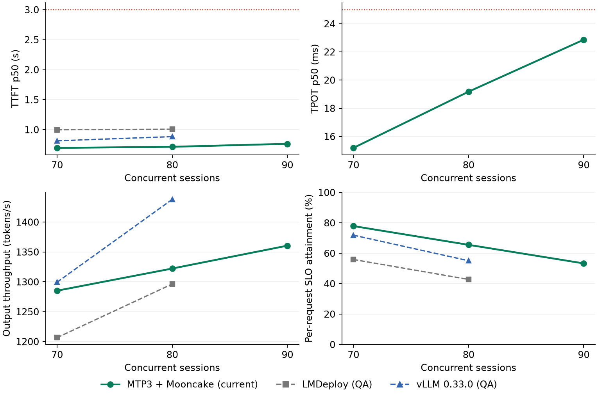

# GLM-5.3-Flash 的 MTP3、Mooncake 与 AgentX 部署对照

这组实验考察当前组合部署的负载边界。目标模型运行 DeepGEMM MegaMoE，开启融合 prefill 和 shared expert，KDA prefill 使用另一个执行优化分支的 FlashKDA。单独衡量 MegaMoE 收益的同深度对照见[基础测量](glm53_sm90_megamoe.md)。本次测试的模型运行时代码可从[执行分支的固定提交](https://github.com/silencelamb/lmdeploy/tree/7b28f6db1b0be75fce186e8522a82bde306d4d97)复核。

## 负载与判定

同一个 Weka 256K 公开数据集、InferenceX AgentX MVP 场景、seed 20260707、流式 chat、服务端 token 计数，每档 1,800 秒。总并发从 70 起步，每次增加 10。每档重新启动服务与 Mooncake Store，使用 MVP 场景的默认轨迹预热。只有完整有效的正式窗口进入比较。

并发升级使用两项中位数，TTFT p50 < 3,000 ms 且 TPOT p50 < 25 ms。TPOT 取 AIPerf 的逐请求 `inter_token_latency.p50`，其分子是首 token 之后的生成耗时。QA 的逐请求 goodput 使用 TTFT 3,000 ms 和单用户输出速率 40 tok/s，同时记录 goodput 目标 0.0074468 req/s。goodput 和达标率与两项中位数分别报告。

## 服务配置

- 单节点 8×H200，DP8 + EP8 + TP1，MTP3。模型 snapshot `3f1971b7b5f7a528c9c4ef6212c8785298a8c24a`，block FP8 权重、BF16 激活与 MLA KV。
- 目标模型使用 `--moe-backend deepgemm_mega_moe`、interleaved FC1、fused shared expert、8,192-token MegaMoE prefill 容量。每 rank 32 个请求槽、8,192-token prefill 预算，session 上限 524,288，KV 块长 64，自动缓存系数 0.7。
- 启用本地 prefix cache 和 `MooncakeStoreConnector` 的 `kv_both` 角色。每 rank 32 个 prefix checkpoint，prefill 对齐 64、只保存末个 checkpoint，decode 首步保存、后续间隔 1,024。router 使用 sticky-least-loaded。
- Mooncake 为嵌入式 RDMA Store，`P2PHANDSHAKE` 元数据，每 rank 160 GiB 全局 segment、4 GiB 本地缓冲，全机 1.25 TiB store，关闭 SSD offload。启动后先在一个 worker 预填充，再到此前未持有该前缀的 worker 读取，核对外部命中计数和响应中的 cached tokens。

与历史 QA 对齐的是客户端场景、数据、种子、窗口与评估目标。旧 QA 表给出 LMDeploy 与 vLLM 0.33.0 的汇总，未附双方完整服务端命令、显存配额及硬件快照。历史表列出 ITL 平均值和 p99、单用户速率 p50；其中没有可直接比较的 TPOT p50。跨部署差值包含上述实现及配置差异。

本次服务使用 Mooncake 0.3.12.post1。RDMA 运行环境提供对应设备、足够的锁页内存以及 NUMA 绑定权限。下面示例中的 `/config/mooncake.json` 对所有 worker 可见，实际 NIC 与 master 地址按部署填写。

```json
{
  "mode": "embedded",
  "metadata_server": "P2PHANDSHAKE",
  "master_server_address": "127.0.0.1:50051",
  "protocol": "rdma",
  "device_name": "mlx5_0,mlx5_1,mlx5_2,mlx5_3,mlx5_4,mlx5_5,mlx5_6,mlx5_7",
  "global_segment_size": "160GB",
  "local_buffer_size": "4GB",
  "enable_offload": false
}
```

启动独立 master 后，使用下列 worker 配置。GPU 通信走单节点 NVLink，Mooncake Store 独立使用 RDMA。对齐生产实例时还需复核实际 worker URL 和管理端口。

```bash
mooncake_master -rpc_port=50051 -rpc_thread_num=4 -default_kv_lease_ttl=30000 \
  -eviction_high_watermark_ratio=0.95 -eviction_ratio=0.1 -logtostderr
# 在另一个终端运行 worker，DeepGEMM 与 FlashKDA provider 已安装。
export GLM53_SPEC_TOKENS=3 GLM53_SESSION_LEN=524288 GLM53_MAX_BATCH_SIZE=32
export GLM53_MAX_PREFILL_TOKENS=8192 LMDEPLOY_GLM53_MEGA_PREFILL_CAPACITY=8192
export LMDEPLOY_GLM53_DEEPGEMM_WEIGHT_LAYOUT=interleaved LMDEPLOY_GLM53_DEEPGEMM_FUSE_SHARED=1
export LMDEPLOY_GLM53_FLASHKDA_LIBRARY="$FLASHKDA_SO" MOONCAKE_CONFIG_PATH=/config/mooncake.json
bash benchmark/glm53_mega_moe/serve.sh "$MODEL_SNAPSHOT" deepgemm_mega_moe \
  --cache-max-entry-count 0.7 --prefill-save-last-only \
  --kv-transfer-config '{"kv_connector":"MooncakeStoreConnector","kv_role":"kv_both","kv_connector_extra_config":{"mooncake_config_path":"/config/mooncake.json","model_name":"glm53-flash"}}'
```

以下为可移植的客户端参数。服务端需使用与集群 NIC 相符的 RDMA 配置，`WORKER_METRICS` 是八个 worker 的监控 URL。

```bash
aiperf profile --scenario inferencex-agentx-mvp --url "$ROUTER_URL" --model glm53-flash \
  --endpoint-type chat --endpoint /v1/chat/completions --streaming --use-server-token-count \
  --tokenizer zai-org/GLM-5.3 --tokenizer-revision e0b07fd2751b42d5efa199cc02c2b271deadc516 \
  --public-dataset semianalysis_cc_traces_weka_062126_256k --max-context-length 256000 \
  --random-seed 20260707 --concurrency "$C" --benchmark-duration 1800 --ui simple \
  --goodput 'time_to_first_token:3000 output_token_throughput_per_user:40' \
  --extra-inputs ignore_eos:true --cache-bust first_turn_prefix --system-idle-gap-cap-seconds 10 \
  --trajectory-start-min-ratio 0 --trajectory-start-max-ratio 1 --artifact-dir "$RUN" \
  --server-metrics "$ROUTER_METRICS" "${WORKER_METRICS[@]}"
python benchmark/glm53_mega_moe/agentx_slo.py "$RUN/profile_export_aiperf.json"
```

评分工具在两项中位数均通过时返回 0，在有效窗口首次越过阈值时返回 10。不可用的提交或错误的正式窗口长度会单独报错。[评分实现](../../../benchmark/glm53_mega_moe/agentx_slo.py)

## 本轮结果

所有列均来自正式 profiling 窗。每个并发档跑一个完整窗口，输入／输出长度和实际到达回合会随闭环回放速度变化。

| 总并发 | 正式有效请求 | TTFT p50 / p95 ms | TPOT p50 / p95 ms | 输出 tok/s | Goodput req/s | 逐请求达标率 | 双 p50 |
| ---: | ---: | ---: | ---: | ---: | ---: | ---: | --- |
| 70 | 2307 | 695.80 / 2,786.85 | 15.19 / 47.57 | 1,285.22 | 0.9766 | 77.89% | 通过 |
| 80 | 2650 | 714.00 / 2,963.41 | 19.18 / 52.94 | 1,322.31 | 0.9440 | 65.55% | 通过 |
| 90 | 2910 | 764.13 / 3,380.09 | 22.87 / 68.45 | 1,360.57 | 0.8435 | 53.33% | 通过 |

最高完整通过档为 C=90。C=100 在正式窗口约 458 秒时按要求停止，样本没有计入比较，实际首次越界并发尚未测定。 在已测且逐请求达标率至少 70% 的档位中，最高 Goodput 为 0.9766 req/s（C=70，达标率 77.89%）。

从 C=70 到 C=90，单用户输出速率 p50 从 65.57 到 43.67 tok/s。全机输出吞吐变化 +5.86%，逐请求达标率变化 -24.56 个百分点。同期平均输入长度从 88,631 变为 78,404 tokens，平均输出长度从 1,025 变为 860 tokens。闭环窗口中不同配置推进到了不同回合。



图中虚线阈值对应两项 p50 目标，曲线只包含完整正式窗口。历史 QA 参照表只列出了至 C=80 的数值。图可通过 `benchmark/glm53_mega_moe/plot_qa_ladder.py` 从配套 JSON 重新生成。

### 与历史 QA 表对照

| C | 部署 | 历史 TTFT p50 ms | 历史输出 tok/s | 当前相对历史输出变化 | 历史 Goodput req/s | 当前相对历史达标率变化 |
| ---: | --- | ---: | ---: | ---: | ---: | ---: |
| 70 | 旧 LMDeploy | 997.50 | 1,206.72 | +6.51% | 0.6978 | +21.99 个百分点 |
| 70 | vLLM 0.33.0 | 814.03 | 1,299.50 | -1.10% | 0.9598 | +5.99 个百分点 |
| 80 | 旧 LMDeploy | 1,007.48 | 1,296.40 | +2.00% | 0.5891 | +22.75 个百分点 |
| 80 | vLLM 0.33.0 | 883.52 | 1,438.04 | -8.05% | 0.8306 | +10.45 个百分点 |

### 实际缓存和提交计数

| C | 客户端缓存读取 tokens 比例 | Mooncake 外部命中 / 查询 tokens | Store 峰值占用 | 每轮平均可提交 tokens | 最低可用 KV tokens/rank | 最高就绪 / 峰值 MiB | 正式 / 预热错误 |
| ---: | ---: | ---: | ---: | ---: | ---: | ---: | ---: |
| 70 | 92.24% | 2,535,488 / 26,950,187 | 85.7% | 3.051 | 3,072,320 | 125,655 / 132,753 | 0 / 43 |
| 80 | 91.27% | 2,749,440 / 31,284,998 | 94.7% | 2.954 | 3,072,320 | 125,543 / 132,419 | 1 / 47 |
| 90 | 90.55% | 4,048,896 / 36,278,012 | 95.0% | 2.939 | 3,072,320 | 125,471 / 131,577 | 0 / 51 |

外部计数取正式窗口八个 worker 的增量，客户端的缓存读取比例包含本地前缀。HBM 峰值取整个回放的 NVML 样本。每档开始前均观察到了跨 worker 恢复的 cached tokens。正式与预热错误按客户端导出分别统计。历史 QA 与本轮的差值为部署级比较，单独隔离 MegaMoE 的增益见[同深度对照](glm53_sm90_megamoe.md)。[机器可读结果](../../../benchmark/glm53_mega_moe/results/qa_agentx_mtp3_mooncake.json)
