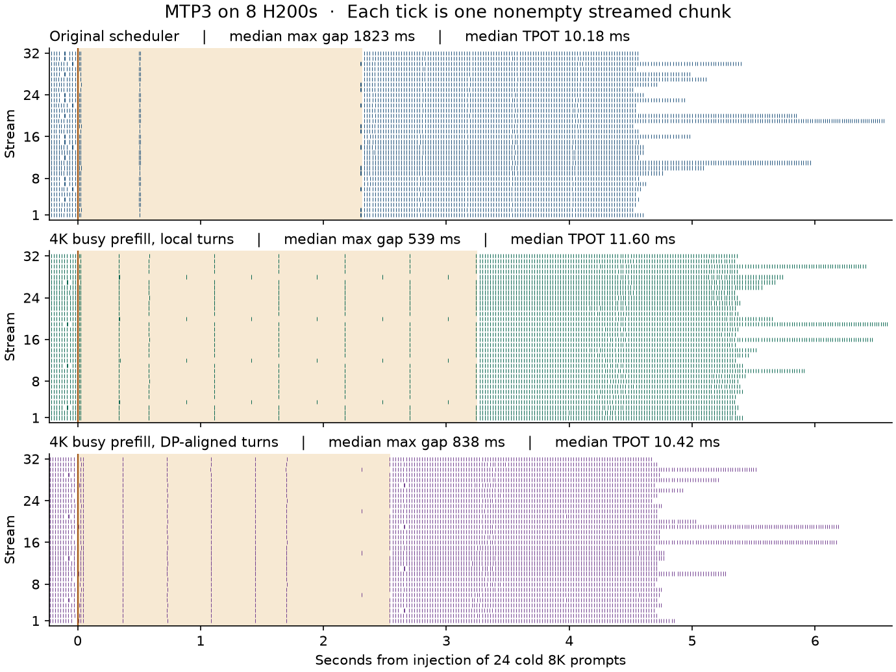

# GLM-5.3-Flash 的调度与生成延迟

本页记录分阶段基线、同一引擎的调度开关实验及 AgentX 上的部署对照。单节点 8×H200，DP8 + EP8 + TP1。LMDeploy 的线上组合使用 DeepGEMM MegaMoE 和可选 FlashKDA。两组的准入、GPU 等待和前端流式输出均计入服务时钟。[机器可读结果](../../../benchmark/glm53_mega_moe/results/h200_scheduling.json)

## MTP0 的生成窗口与请求补入

8K 输入、256 输出、C=64。把首批 64 个请求按开始时间排序，确认每 rank 有 8 条，各自已产生首 token，且整个测量区间内没有请求完成或新请求补入。取每条请求第 33～224 个输出 token 的 191 个间隔。两轮 LMDeploy 平均 16.26 ms/token，同机 vLLM `5328ae2fef` 为 14.53 ms/token。收窄到第 65～192 个 token 可以复核结论。脚本在这些边界不成立时直接报错。[窗口提取代码](../../../benchmark/glm53_mega_moe/decode_window.py)

| 8K/256、C=64，滚动 256 个请求 | LMDeploy | vLLM |
| --- | ---: | ---: |
| 总输出 tok/s | 1,702 | 1,948 |
| 平均 TTFT | 3.287 s | 1.481 s |
| 首次调度前排队 | 2.084 s | 0.626 s |
| 首次调度到首 token | 1.192 s | 0.835 s |
| 首 token 到完成 | 6.313 s | 6.890 s |

首次调度前的差值占平均 TTFT 差距的 80.8%。从首 token 到完成的时长还包括其他请求进入 prefill、batch 改变及等待下一次前向的时间。因此，纯生成窗口和滚动服务必须分别比较。LMDeploy 每档两次完整成功启动，vLLM 为本轮一次。

## 带 MTP 的验收

MTP5 的另一组配对试验在相同验证深度下出现了不同的瓶颈。8K/256、C=64 的两边每轮可提交约 4.61 / 4.63 个 token。平均排队仅差 0.29 秒，首 token 到完成却差 3.34 秒。C=32 时，在至多 32 条探针都输出 32 个 token 后，再投递 24 条冷 8K prompt。在 LMDeploy 中，50 对探针连 512 个输出 ID 都完全一致，TPOT 的配对中位差仍为 +3.82 ms。此处改变的是现有服务上的负载；新调度的收益需要同引擎开关实验。

MTP0、MTP3、MTP5 每条在途请求一轮最多需要 1、4、6 个目标模型 query token，接受后实际推进的 token 数由运行时计数给出。下列调度实验以 MTP3 为上线候选，MTP0 单独评估。

## 忙时 prefill 与在途生成的轮次

在同一 rank 上，每次 forward 仍取一种工作。混部引擎发现有可以继续生成的请求时，可为新准入的 prefill 指定较小的 token 预算。队列排序、前缀命中后的实际剩余长度、整批计费、首次 KV 分配和 chunker 共用这份预算。已经开始的长请求按准入时选定的块长续跑，遇到 checkpoint 边界可再截短。不可分割的多模态输入沿用模型已有的最小完整跨度。rank 空闲时新请求可使用完整的引擎预算。

每次实际提交 prefill 后，可以优先给在途请求若干个 decode 或 MTP 验证轮次。候选调度还可复用 DP 已收集的元数据，在 worker 输出中附带一个集体前向轮次编号。host 考虑已预取的一步，尽量让各忙碌 rank 在相同余数的轮次接纳 prefill。全机 dummy 轮次跳过计数，空闲 rank 可立即处理请求。在 host 错过相位时，本地等待上限会重新允许准入。这条提示只影响选工作顺序，无需增加 collective 或等待其他 rank 的调度决定。[运行时变更](https://github.com/silencelamb/lmdeploy/commit/8ff9e72d)

| 环境变量 | 含义 |
| --- | --- |
| `LMDEPLOY_INTERLEAVED_PREFILL_TOKENS` | 默认为 0。正数启用策略并设置有在途生成时的新 prefill 预算，上限为引擎的 `max_prefill_token_num`。 |
| `LMDEPLOY_INTERLEAVED_DECODE_ROUNDS` | 本地策略每次 prefill 后优先保留的生成轮数，默认 1。设为 0 可单测分块。 |
| `LMDEPLOY_DP_PREFILL_PERIOD` | 默认 0。大于 1 且收到 DP 反馈后，改用公共轮次安排准入，数值是以真实集体前向为单位的周期。 |
| `LMDEPLOY_DP_PREFILL_TRACE` | 设为 1 时 rank 0 记录每次 prefill 的轮次、各 rank token 数及做 prefill 的 rank 数，便于复核对齐情况。 |

固定负载在单机 8×H200 上按作业独占运行。MTP0 使用 524,288 session 和 49,152 KV blocks/rank，MTP3 的固定形状测试使用 32,768 session 和 14,058 blocks/rank。开关比较在相同深度和配置内进行。8K/256 测量为闭环 C64，least-loaded 放置。MTP0 单次启动滚动 256 个请求，MTP3 单次启动按两个固定种子各滚动 256 个请求。TPOT 用每条请求首、末流式输出间的时长除以实际输出 token 数减一。额外注入实验按每条探针最久一次连续流式输出间隔取 p50，每条探针生成 512 个 token。

## MTP3 的受控长 prefill 补入

先在 8 个 rank 各启动 4 条 1K 输入、512 输出的探针。等所有探针都收到至少 32 个输出 token，再同时补入 24 条独立的冷 8K prompt，每条只生成 1 个 token。每次启动做两轮，分别使用先单跑、后注入和相反顺序。图中每个短竖线代表前端对一条在途请求交付的一次非空流式输出，淡黄色区间从注入一直到所有新 prompt 完成。图取第一轮。表中探针指标合并两轮的 64 条请求，滚动服务另统计 512 条 8K 请求。

| 首组同种子对照 | 原调度 | 忙时 4K、本地轮转 | 忙时 4K、DP 对齐周期 2 |
| --- | ---: | ---: | ---: |
| 没有额外 prefill 的 TPOT p50 | 5.67 ms | 5.72 ms | 5.60 ms |
| 补入后的最长流式停顿 p50 | 1,810 ms | 535 ms | 614 ms |
| 补入后的整段 TPOT p50 | 9.98 ms | 11.50 ms | 10.18 ms |
| 24 条冷 prompt 全部完成，两轮 | 2.32 / 2.30 s | 3.25 / 3.20 s | 2.54 / 2.38 s |
| 8K/256 C64 滚动流量每轮平均可提交 token | 3.508 | 3.513 | 3.526 |

给验证留出轮次后，已有请求在冷输入处理期间多次收到了输出。本地轮转让处理这批冷输入的总时间延长了约 0.9 秒，整段 TPOT 也随之上升。跨 rank 对齐回收了其中大部分额外时间，同时仍然能在多个间隔交付输出。这组滚动服务中两种策略的实际每轮提交量接近。流式连续性、实际每 token 时延和整机吞吐需要分别验收。[重绘时间线](../../../benchmark/glm53_mega_moe/plot_scheduling_interference.py)

8K/256 的首个原调度服务为 1,105 tok/s，TPOT p95 80.14 ms。本地 4K 轮转为 1,189 tok/s、70.61 ms。加入 DP 周期 2 后，首次启动为 1,438 tok/s、54.52 ms，使用两个公开分支组合后的独立启动为 1,470 tok/s、53.55 ms。后两次的 TTFT p95 分别为 5.43 和 5.32 秒，首个原调度服务为 4.78 秒。固定负载里缩短生成时延，也可能让部分新到的请求更晚收到首 token。

## AgentX C90 上的 MTP3 部署对照

原调度、忙时 4K 本地轮转、忙时 4K 跨 rank 对齐各独立运行一个 1,800 秒正式窗口。三组均使用 Weka 256K、seed 20260707、DP8/EP8、同一个路由策略、MTP3、FlashKDA 和 160 GiB/worker 的 RDMA Mooncake，均通过 AIPerf 的提交有效性校验。每组都重启服务和 Store，多轮闭环回放会产生不同的完成请求集合。[配置和原调度阶梯](glm53_agentx_mooncake.md)

| 正式窗口 | 原调度 | 忙时 4K、本地轮转 | 忙时 4K、DP 周期 2 |
| --- | ---: | ---: | ---: |
| TTFT p50 / p95 | 764.13 / 3,380.09 ms | 741.02 / 4,181.35 ms | 726.71 / 3,602.19 ms |
| TPOT p50 / p95 | 22.87 / 68.45 ms | 23.44 / 68.51 ms | 22.45 / 58.13 ms |
| 整机输出吞吐 | 1,360.57 tok/s | 1,359.75 tok/s | 1,433.65 tok/s |
| 逐请求达标数 / 完成数 | 1,552 / 2,910 | 1,495 / 2,905 | 1,707 / 3,042 |
| 逐请求达标率 / goodput | 53.33% / 0.8435 req/s | 51.46% / 0.8125 req/s | 56.11% / 0.9277 req/s |
| 已读缓存 token 占输入比例 | 90.55% | 90.54% | 90.66% |
| 平均每轮可提交 token | 2.939 | 2.961 | 2.954 |

三个窗口均通过两项中位数 SLO。正式窗中每种策略分别完成 2,910、2,905、3,042 条请求，AIPerf 分别记录 51、54、58 条预热请求只返回元数据或空内容，标记为 `InvalidInferenceResultError`。这些预热请求不参与正式计分。正式窗口无请求错误。

同一套部署下，对齐版本的输出吞吐增加 5.37%，逐请求达标率增加 2.78 个百分点，goodput 增加 9.99%。TPOT p95 降低 15.08%，p99 从 123.31 降到 85.05 ms。首 token 的中位数改善 37.42 ms，p95 增加 222.11 ms。MTP3 可将此策略列为上线候选，并以业务的 TTFT 尾延迟要求决定是否启用。每种策略的部署数据各来自一个正式窗。

按源轨迹和 turn 配对，原调度与对齐版本共有 2,901 对，候选减去原调度的 TPOT 中位差为 −0.686 ms，逐请求达标数 1,552 → 1,612。再限定输入长度、输出长度和已读缓存 token 数相同，剩下 669 对，TPOT 中位差 −0.175 ms，达标数 385 → 364。这一子集说明收益不能外推到每一类请求。本地轮转与原调度有 2,882 对，TPOT 中位差 +0.204 ms。[配对复核工具](../../../benchmark/glm53_mega_moe/compare_agentx_scheduling.py)

原调度八个 worker 的等待队列长度 p95 均为 1。各 worker 的时间平均值取均值，等待 0.081 条、运行 4.517 条。固定负载中的排队改善不足以预测 AgentX 的部署收益。历史 QA 的 vLLM 0.33.0 表最高到 C80，此处的 C90 是同一 LMDeploy 引擎的对照。

## 状态与缓存正确性

调度、MTP 停止与恢复、compact-state 生命周期和 Mooncake connector 的相关测试在有 GPU 的发布工作树上运行，共 819 项通过。另在开启忙时 4K 的 MTP3 服务上，向所有 rank 已在生成的探针补入 65,536-token 检索请求。两个批次共 16 条，六位检索口令全部正确，覆盖上下文深度 5%、25%、55%、90%。同时运行的 32 条探针均完整交付 512 个 token。正式 C90 开始前的跨 worker 存储预检也观察到了外部命中。

## 同一 forward 混批的实现边界

真正共用一次 forward 还需从 GPU 端保留的 `StepInputs` 取出已有 decode 行。MTP3 每行要同时携带目标 token、草稿和实际拒绝数。计划先让 MTP0 使用按行的 query 长度和 KV 预留，给两个阶段分别构造 KDA/MLA 所需的元数据，再合用其余层的前向。随后为 MTP3 覆盖零接受、部分接受、停止和 prefix/compact-state 恢复。纯 decode 窗口、滚动服务和集中注入的测量分别报告，便于定位收益来源。

## 复现

每个策略用独立的服务进程、相同模型和 KV 配额，服务端环境在启动前设置。MTP3 的本地 4K 候选设 `LMDEPLOY_INTERLEAVED_PREFILL_TOKENS=4096` 和 `LMDEPLOY_INTERLEAVED_DECODE_ROUNDS=1`。MTP0 的 8K、两轮相位实验设 `LMDEPLOY_INTERLEAVED_PREFILL_TOKENS=8192`、`LMDEPLOY_DP_PREFILL_PERIOD=2`。调度关闭的对照将第一个变量设为 0。测 packing 时在对照和候选两边同时开 trace。测得的数据使用 MegaMoE、FlashKDA 和相同的执行设置，两个 runtime 增量可单独合并。[执行基线](https://github.com/silencelamb/lmdeploy/tree/ae81066e66481aeb3972c67332bdcee3c07673f1) · [调度增量](https://github.com/silencelamb/lmdeploy/commit/8ff9e72d)

MTP0 的客户端接受八个 worker 的 `--urls`、模型目录 `--tokenizer` 和空的 `--output` 路径。MTP3 的客户端使用相同参数并增加 `--draft-depth 3`。每次服务运行将客户端输出存到 `fixed/`，保留 `server-command.sh`、`server.env`（若传入）、`server.log` 和 `exit_code`。用 `python benchmark/glm53_mega_moe/summarize_scheduling.py RUN [RUN ...]` 校验流式 token、每次重复的样本量、实际草稿宽度，再从原始到达时刻重算分位数和吞吐。DP trace 统计使用同机时钟与测量前后的 worker 快照写入时刻划定每个滚动窗口。[MTP0 客户端](../../../benchmark/glm53_mega_moe/scheduling_fixed_io.py) · [MTP3 客户端](https://github.com/silencelamb/lmdeploy/blob/ae81066e66481aeb3972c67332bdcee3c07673f1/benchmark/glm53_mega_moe/mtp_interference.py) · [结果汇总工具](../../../benchmark/glm53_mega_moe/summarize_scheduling.py)
